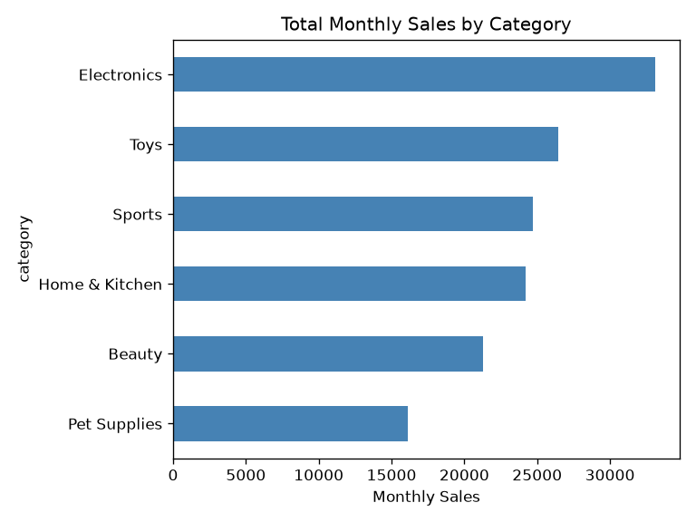
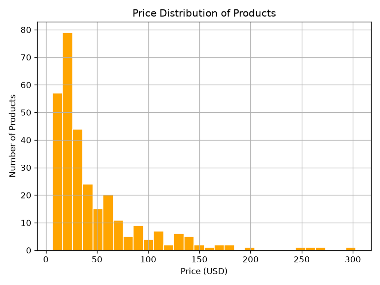
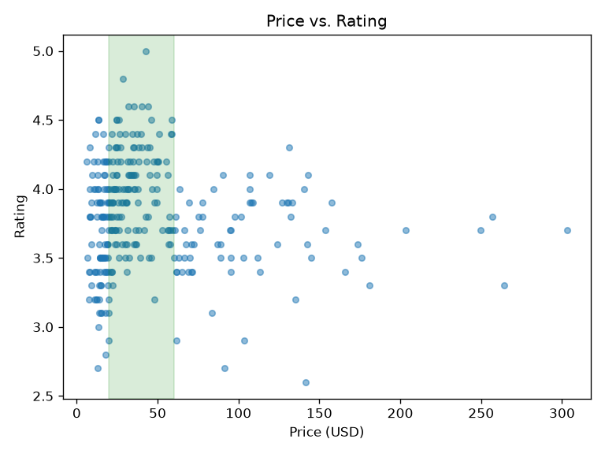
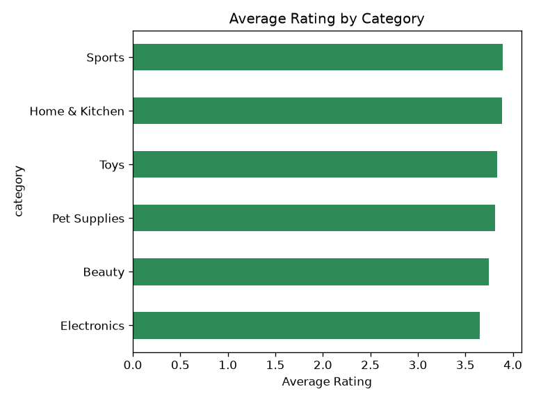

# Product Selection Analysis for Cross-Border E-Commerce

A small data analysis project that answers one core question for cross-border
e-commerce sellers: **which products are worth selling?**

Using Python (pandas + matplotlib), I analyze a product catalog across six
categories and surface three actionable insights for product selection.

## Data

`data/products.csv` — a realistic product catalog (300 products, 6 categories):

| Field | Description |
| --- | --- |
| product_id | Unique product identifier |
| name | Product name |
| category | Product category |
| price_usd | Selling price (USD) |
| rating | Average customer rating (1–5) |
| review_count | Number of customer reviews |
| monthly_sales | Estimated monthly units sold |

> The dataset is generated by `generate_data.py` with a fixed random seed, so
> results are fully reproducible. Its structure mirrors real cross-border
> marketplace data and can be swapped for a public dataset (e.g. Olist) without
> changing the analysis code.

## Key Findings

1. **Electronics is a "red ocean."** It drives the highest total sales
   (33,130 units/month) but has the *lowest* average rating (3.65). High demand,
   but crowded and full of quality complaints — risky for a newcomer.

2. **Sports is the under-valued opportunity.** It has the *highest* average
   rating (3.89) but only mid-level sales (24,707). Good product quality with
   relatively low competition — a candidate for growth.

3. **The $20–$60 "sweet spot" works.** Products priced in this range average a
   3.99 rating, versus 3.65 outside it. Mid-priced products deliver the best
   value-to-quality balance.

## Charts









## How to Run

```bash
python -m venv venv
# activate the environment, then:
pip install pandas matplotlib
python generate_data.py   # creates data/products.csv
python analysis.py        # prints findings and saves charts to charts/
```

## Author

Liu Zihan — a CS student building a portfolio at the intersection of English
and technology, aiming for a cross-border e-commerce role.
